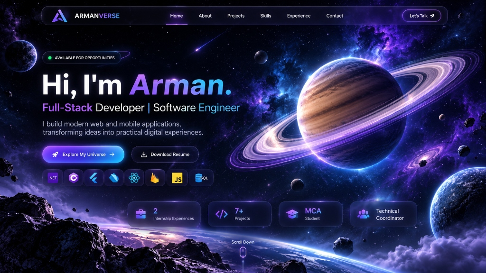

# ARMANVERSE — Futuristic 3D Space Developer Portfolio

> **"Explore My Universe."**  
> Official 3D interactive portfolio for **Arman Mulla** — Full-Stack Developer & Software Engineer.



---

## 🌌 Overview

**ARMANVERSE** is a high-performance, futuristic 3D developer portfolio designed to immerse visitors in a living cosmic galaxy. Built with **React**, **TypeScript**, **Three.js**, and **Tailwind CSS**, it features:

- **Real-Time 3D Saturn**: High-fidelity procedural planetary surface, independent concentric ring rotation with Cassini division & translucent dust, atmospheric Fresnel halo, and floating asteroid field.
- **Dynamic Deep Space**: Thousands of twinkling star particles, streaking shooting stars, and multi-layered glowing nebulas.
- **Glassmorphism UI**: Frosted glass panels, glowing borders, active navigation tracking, and smooth cosmic micro-interactions.
- **Planetary Project Orbit**: Dedicated project cards representing distinct planetary deployments with live links and mission telemetry modals.
- **Interactive Technology Galaxy**: Interactive orbital stack categorized by Programming, Frameworks, Backend, Database, and Dev Tools.
- **Mission History**: Futuristic mission-control timeline logging internship milestones and student leadership roles.
- **Subspace Communications**: Validated contact transmission form with spam honeypot, one-click email copying, resume download, and celebratory cosmic particle effects.
- **Mission Control Admin**: Clearance-protected dashboard to inspect inbound transmissions and monitor Firebase configuration.

---

## 🛠️ Technology Stack

| Layer | Technologies |
|---|---|
| **Core** | React 19, TypeScript, Vite |
| **3D & Graphics** | Three.js (WebGL), 2D Canvas Procedural Textures |
| **Styling** | Tailwind CSS 3.4, PostCSS, Vanilla Glassmorphism |
| **Icons & Effects** | Lucide React, Canvas Confetti |
| **Fonts** | Orbitron, Outfit, Inter, Fira Code |
| **Backend & Cloud** | Firebase Firestore, Firebase Hosting, Firebase Auth (Security Rules ready) |

---

## 📁 Project Structure

```
shivam-s-portfolio/
├── public/
│   ├── favicon.svg               # Futuristic cosmic SVG favicon
│   ├── images/
│   │   └── armanverse-hero-bg.jpg # Space galaxy reference & fallback
│   ├── resume-arman-mulla.pdf    # Verified downloadable PDF resume
│   ├── robots.txt                # Search engine crawler directives
│   └── sitemap.xml               # SEO sitemap
├── src/
│   ├── components/
│   │   ├── Admin/
│   │   │   └── AdminModal.tsx    # Clearance-gated mission control dashboard
│   │   ├── Background/
│   │   │   └── SpaceBackground.tsx # Composite 3D Saturn, stars & nebula
│   │   ├── Footer/
│   │   │   └── Footer.tsx        # Cosmic footer with quick links & admin trigger
│   │   ├── Icons/
│   │   │   └── SocialIcons.tsx   # Crisp SVG brand icons (GitHub, LinkedIn, Instagram)
│   │   ├── LoadingScreen/
│   │   │   └── LoadingScreen.tsx # Cinematic initial subspace bootloader
│   │   ├── Navbar/
│   │   │   └── Navbar.tsx        # Floating glass navigation bar
│   │   ├── Saturn/
│   │   │   └── SaturnScene.tsx   # Real-time 3D Three.js Saturn & ring system
│   │   ├── ShootingStars/
│   │   │   └── ShootingStars.tsx # Animated streaking meteors
│   │   └── StarField/
│   │       └── StarField.tsx     # High-performance 2D Canvas star particles
│   ├── data/
│   │   └── portfolioData.ts      # Authentic candidate data, projects & timeline
│   ├── sections/
│   │   ├── HeroSection.tsx       # Hero with badge, actions & achievement stats
│   │   ├── AboutSection.tsx      # Journey timeline, education & avatar
│   │   ├── ProjectsSection.tsx   # Planetary project gallery & details modal
│   │   ├── SkillsSection.tsx     # Orbital tech stack categorized by layer
│   │   ├── ExperienceSection.tsx # Mission history telemetry & leadership
│   │   └── ContactSection.tsx    # Subspace transmission form & direct links
│   ├── types/
│   │   └── index.ts              # Clean TypeScript interfaces
│   ├── utils/
│   │   └── textureGenerators.ts  # Procedural canvas textures for Saturn & rings
│   ├── App.tsx                   # Main SPA coordinator & motion manager
│   ├── index.css                 # Cosmic design tokens & Tailwind utilities
│   └── main.tsx                  # Application entry point
├── package.json
├── tailwind.config.js
├── tsconfig.json
└── vite.config.ts
```

---

## 🚀 Installation & Local Development

### 1. Prerequisites
- **Node.js**: v18.0.0 or higher (v20+ recommended)
- **npm**: v9.0.0 or higher

### 2. Install Dependencies
```bash
npm install --legacy-peer-deps
```

### 3. Start Development Server
```bash
npm run dev
```
Open [http://localhost:5173](http://localhost:5173) in your browser.

---

## 📦 Production Build & Deployment

### Build Bundle
```bash
npm run build
```
This compiles the TypeScript code and produces an optimized production bundle in the `dist/` directory.

### Preview Production Build Locally
```bash
npm run preview
```

### Deploy to Firebase Hosting
```bash
# 1. Install Firebase CLI globally (if not already installed)
npm install -g firebase-tools

# 2. Login to your Firebase account
firebase login

# 3. Initialize Firebase in this project
firebase init hosting
# -> Select "dist" as public directory
# -> Configure as single-page app (rewrite all urls to /index.html): Yes

# 4. Deploy
firebase deploy --only hosting
```

---

## 🔒 Security & Environment Variables

- Zero client-side API secrets are exposed.
- Contact transmission form includes honeypot bot filtering and client-side payload sanitization.
- Firebase Firestore Security Rules pattern:
```javascript
rules_version = '2';
service cloud.firestore {
  match /databases/{database}/documents {
    match /projects/{project} {
      allow read: if true;
      allow write: if request.auth != null;
    }
    match /contacts/{msg} {
      allow create: if true;
      allow read, write: if request.auth != null;
    }
  }
}
```

---

## 🪐 Candidate Information

- **Name**: Arman Mulla
- **Role**: Full-Stack Developer | Software Engineer
- **Education**: 
  - Master of Computer Applications (MCA) — TKIET Warananagar
  - Bachelor of Computer Applications (BCA) — YCMOU
- **Core Technologies**: .NET, C#, Flutter, Dart, React, Firebase, JavaScript, SQL
- **Contact Email**: armanmulla.dev@gmail.com
- **LinkedIn**: [linkedin.com/in/arman-mulla-019672276](https://www.linkedin.com/in/arman-mulla-019672276/)
- **GitHub**: [github.com/ArmanMulla](https://github.com/ArmanMulla)

---

## 📜 License
This project is open-source under the [MIT License](LICENSE).
